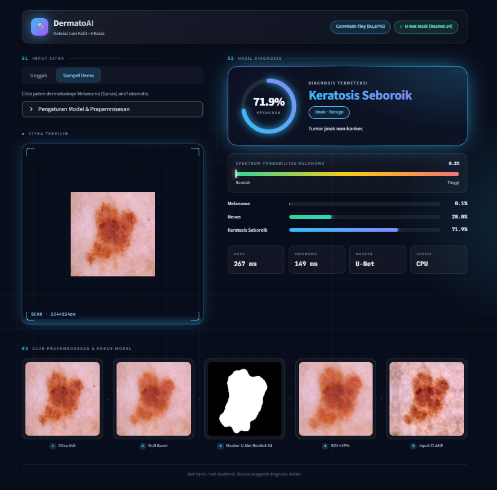
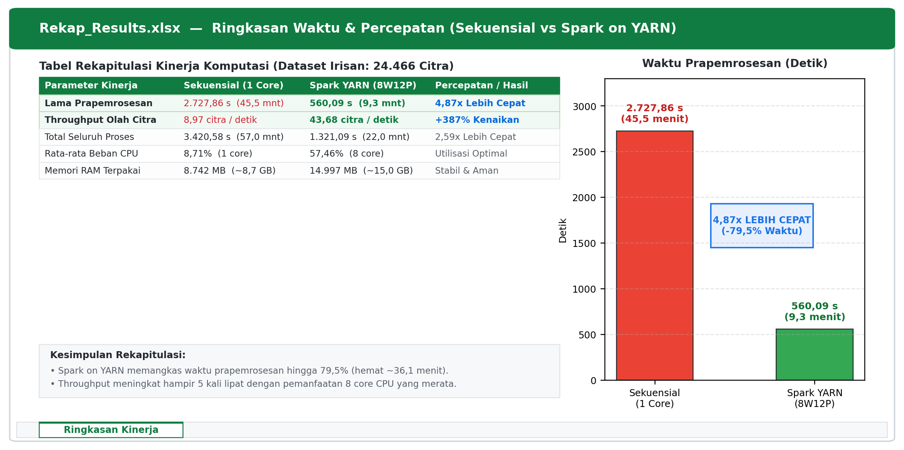

# 🔬 DermatoAI — Sistem Deteksi Kanker Kulit Berbasis Deep Learning & Big Data Spark on YARN

<p align="center">
  
</p>

<p align="center">
  <a href="https://dermatoai-4465465.streamlit.app/"></a>
  <a href="https://github.com/Sigiitttt/dermato_ai/releases/tag/v1.0"></a>
  
  
  
</p>

DermatoAI adalah sistem aplikasi diagnosis citra dermoskopi berbasis Deep Learning dengan arsitektur **ConvNeXt-Tiny** dan segmentasi otomatis **U-Net (ResNet-34)**. Sistem ini mengklasifikasikan 3 kelas lesi kulit (*Melanoma*, *Melanocytic Nevus*, dan *Seborrheic Keratosis*) dengan akurasi uji **83,87%**, Macro F1-Score **0,7867**, dan AUC **0,9360** pada 2.343 citra uji independen bebas kebocoran lesi (*zero-leakage split*).

Aplikasi dilengkapi alur prapemrosesan medis standar (*Dull Razor hair removal*, *segmentasi U-Net*, *ROI cropping 15% margin*, *CLAHE*, dan *Letterbox padding 224×224*) serta visualisasi interpretasi klinis interaktif (*Circular Confidence Gauge*, *Melanoma Risk Spectrum*, dan *Grad-CAM Heatmap*).

---

## ⚡ Akses Modul & Notebook Riset

| Modul | Direktori | Berkas Utama | Deskripsi & Hasil Kunci |
| :---: | :--- | :--- | :--- |
| **Segmentasi** | [`segmentasi/`](segmentasi/) | [`00_train_unet_segmentasi_ham10k.ipynb`](segmentasi/00_train_unet_segmentasi_ham10k.ipynb) | Pelatihan U-Net ResNet-34 pada data ground truth dokter HAM10k untuk menghasilkan masker otomatis (pseudo-mask) bagi 24.466 citra. |
| **Spark on YARN** | [`spark_dan_baseline/`](spark_dan_baseline/) | [`8w12p.ipynb`](spark_dan_baseline/8w12p.ipynb) | **Prapemrosesan Big Data Terdistribusi:** 8 Worker, 12 Partisi, HDFS Sharding, prapemrosesan **560,09 detik** (4,87x lebih cepat), pelatihan ConvNeXt-Tiny (**Akurasi 83,87%**, AUC 0,9360). |
| **Baseline Sekuensial** | [`spark_dan_baseline/`](spark_dan_baseline/) | [`Irisan_convnext_tiny_tanpa_spark (1).ipynb`](<spark_dan_baseline/Irisan_convnext_tiny_tanpa_spark (1).ipynb>) | **Baseline Acuan (Non-Spark):** Prapemrosesan citra satu per satu pada 1 core CPU (**2.727,86 detik** / 45,46 menit). |
| **Aplikasi Web** | [`app/`](app/) | [`app/app.py`](app/app.py) | Implementasi aplikasi antarmuka web Streamlit Cloud beserta berkas dependensi dan sampel uji. [Akses Web App](https://dermatoai-4465465.streamlit.app/). |

---

## 📊 Hasil Komparasi: Spark on YARN (8W12P) vs Sekuensial

<p align="center">
  
</p>

### Ringkasan Kinerja Empiris (24.466 Citra Medis):
* **Prapemrosesan Citra:** Terpangkas dari **2.727,86 detik (45,46 menit)** pada baseline sekuensial menjadi **560,09 detik (9,33 menit)** pada Spark 8W12P (**4,87x Lebih Cepat**, memangkas waktu 79,5%).
* **Throughput Komputasi:** Meningkat dari **8,97 citra/detik** menjadi **43,68 citra/detik** (+387%).
* **Pemanfaatan Sumber Daya:** Beban 8 core CPU klaster terdistribusi merata (rata-rata CPU 57,46%, RAM 14.997 MB) tanpa terjadi lonjakan memori (OOM) maupun kegagalan kontainer YARN.
* **Performa Model ConvNeXt-Tiny (2.343 Citra Uji Independen):**
  * **Test Accuracy:** **83,87%**
  * **Macro F1-Score:** **0,7867**
  * **ROC-AUC (One-vs-Rest):** **0,9360**
  * **Melanoma Recall (Kanker Ganas):** **70,93%**
  * **Seborrheic Keratosis Recall:** **73,08%**
  * **Nevus Precision:** **0,89**

---

## 🗄️ Tautan Dataset Kaggle Resmi (Reproducibility)

Seluruh notebook riset mengunduh dataset secara otomatis via pustaka `kagglehub`. Berikut tautan publik dataset yang digunakan:

1. 📄 **[ham10k-and-isic-2019](https://www.kaggle.com/datasets/nadiraanindita/ham10k-and-isic-2019):** Berkas manifest partisi Train (19.713), Validation (2.410), dan Test (2.343) dengan pembagian bebas kebocoran lesi (*zero-leakage patient lesion split*).
2. 🖼️ **[dataset-riset-ham10k](https://www.kaggle.com/datasets/nadiraanindita/dataset-riset-ham10k):** Arsip citra dermoskopi HAM10000 asli.
3. 🖼️ **[dataset-riset-isic-2019](https://www.kaggle.com/datasets/nadiraanindita/dataset-riset-isic-2019):** Arsip citra dermoskopi ISIC 2019 asli.
4. 🎭 **[ham-segmentations-lesion-riset-saya](https://www.kaggle.com/datasets/nadiraanindita/ham-segmentations-lesion-riset-saya):** Masker segmentasi biner lesi kulit resmi dari dokter spesialis kulit (HAM10000).
5. 🎭 **[isic2019-pseudo-masks-zip](https://www.kaggle.com/datasets/nadiraanindita/isic2019-pseudo-masks-zip):** Masker segmentasi hasil inferensi model U-Net untuk citra ISIC 2019.

---

## 💾 Unduhan Bobot Model Pre-trained

Berkas bobot model telah disimpan dan dirilis secara publik melalui GitHub Releases:

* 📦 **[Unduh models.zip (GitHub Releases v1.0)](https://github.com/Sigiitttt/dermato_ai/releases/tag/v1.0)** (Ukuran: 185 MB)
  * `best_convnext_tiny_irisan_8W12P_r1.pt` (110 MB) — Bobot model klasifikasi 3-kelas ConvNeXt-Tiny.
  * `best_mask.pth` (98 MB) — Bobot model segmentasi U-Net ResNet-34.

Saat dijalankan di Streamlit Cloud, aplikasi otomatis mengunduh dan mengekstrak berkas bobot ini pada proses *cold start*.

---

## 📁 Struktur Direktori Repositori

```text
dermato_ai/
├── app/                                           # Berkas aplikasi Streamlit
│   ├── app.py                                     # Skrip antarmuka web Streamlit
│   ├── requirements.txt                           # Dependensi modul web
│   ├── samples/                                   # Contoh citra dermatoskopi paten
│   │   ├── melanoma.jpg
│   │   ├── nevus.jpg
│   │   └── seborrheic_keratosis.jpg
│   └── README.md                                  # Dokumentasi modul aplikasi
├── segmentasi/                                    # Modul segmentasi U-Net
│   ├── 00_train_unet_segmentasi_ham10k.ipynb      # Pembuatan masker segmentasi U-Net
│   └── README.md                                  # Dokumentasi segmentasi
├── spark_dan_baseline/                            # Eksperimen komputasi terdistribusi vs baseline
│   ├── 8w12p.ipynb                                # Spark on YARN 8 Worker, 12 Partisi
│   ├── Irisan_convnext_tiny_tanpa_spark (1).ipynb # Baseline sekuensial (1 core)
│   └── README.md                                  # Dokumentasi komparasi kinerja
├── app.py                                         # Entrypoint launcher (Streamlit Cloud root)
├── requirements.txt                               # Dependensi root
├── demo_preview.png                               # Preview antarmuka DermatoAI
├── gambar_13_rekap_excel.png                      # Visual komparasi Spark vs Sekuensial
└── README.md                                      # Dokumentasi repositori
```

---

## 💻 Cara Menjalankan Aplikasi Secara Lokal

```bash
# 1. Kloning repositori
git clone https://github.com/Sigiitttt/dermato_ai.git
cd dermato_ai

# 2. Pasang dependensi
pip install -r requirements.txt

# 3. Jalankan aplikasi Streamlit
streamlit run app.py
```
Aplikasi akan otomatis terbuka pada browser di `http://localhost:8501`.

---

## ⚖️ Penafian Medis (*Disclaimer*)
Aplikasi ini dikembangkan sebagai luaran riset dan alat bantu skrining awal (*decision support tool*). Aplikasi ini **bukan pengganti** diagnosis resmi dari dokter spesialis dermatologi atau pemeriksaan histopatologi (biopsi).
